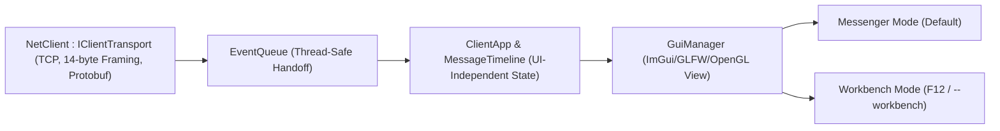

# 클라이언트 UI 및 개발 워크벤치 설계

> **문서 상태 구분**
> - **구현 완료 범위(`Step 1`)**: `client_gui`의 `IClientTransport` 분리, 구조화 `ChatLogLine` 및 `MessageTimeline`, `NetClient` `MSG_PING`/`MSG_PONG` RTT 측정, 기본 `Messenger` 모드와 `F12`/`--workbench` 기반 `Workbench` 진단 서랍, 개인 차단(`/block`·`/unblock`·`/blacklist list`) 연동 및 단위 테스트(`MessageTimelineTest`, `ClientAppTest`)·스모크 테스트를 구현했다.
> - **구현 완료 범위(`Step 1.1`)**: 프레임버퍼 DPI 스케일 연동 폰트 선명도(`PixelSnap` 및 래스터 밀도 보정), 레이아웃 간격·비율 개선, Windows IMM32 서브클래싱 기반 별도 조합 박스 없는 버퍼 직접 CJK/한글 조합(`preedit`) UX를 구현·검증했다.
> - **구현 완료 범위(`Step 1.2` / `Step 1.2.1`)**: 연속 발신자 메시지 그룹화(`can_group_chat_lines`, 60초 창) 및 디스코드 수준의 촘촘한 대화 밀도(`2px` 행 간격·한 줄 인라인 `[SYS]`/`[ERR]` 배지), 귓속말 좌측 액센트 카드, `Chat` 헤더 컴팩트 `Whispers` 토글 및 `Navigation`/`Chat`/`Participants` 내부 목록 패딩·단일 스크롤 분리, 차단 사용자 메시지 숨김/접기 토글(차단 존재 시 `Participants` 하단 컴팩트 `Hide in chat`), 빈 상태·미연결 온보딩 카드, 타임라인 우클릭 컨텍스트 메뉴 및 `Diagnostics` 원클릭 복사, 1:1 귓속말 스레드(`WHISPER_PEER`)·미읽음 배지(`ClientApp` unread tracking), `InputHistory`(`Up`/`Down` + IME 안전 취소), `Ctrl+F` 인라인 검색, 가중 글자수 기반 입력 상한(유니코드 `1,000`자 / 로마자 계열 `2,000`자) 및 실시간 글자수 카운터를 구현·검증했다.
> - **구현 완료 범위(`Step 1.3`, `P2`)**: `ClientPreferences` 비비밀 로컬 환경설정 저장·로드(`access_token`·`resume_token`·비밀번호 원문 저장/로드 차단), CLI 인자(`--host`, `--port`, `--user`, `--workbench`, `--messenger`, `--auto-resume`, `--no-auto-resume`, `--config`), 선택형 `Auto-Resume` 지수 백오프 재연결(수동 `disconnect()` 시 미발동·만료 시 중단·최대 5회 `1s..16s`), 10초 주기 `Auto Ping` 토글과 슬라이딩 min/avg/max RTT 요약, `Resume TTL` 실시간 카운트다운, `Diagnostics` **`Inspector` / `Protocol Log`** 탭(비밀 비노출 250건 링 버퍼·필터·`Hide PING/PONG`·복사/초기화)을 구현·검증했다.
> - **설계 기준([client_gui README](../../client_gui/README.md))**: 아래 계층 책임과 실패·보안 불변식은 구현 검증의 기준 사양으로 유지한다. (웹 관리 콘솔 `Step 2~4`는 [웹 관리 콘솔 설계](web-admin-console.md)에서 별도로 다룬다.)

## 목적과 경계

Dynaxis 클라이언트는 두 가지 서로 다른 요구를 **단일 실행 파일과 단일 상태 모델** 안에서 동시에 만족해야 한다.

1. 일반 채팅과 운영 시연을 보여 줄 때는 개발자용 디버그 수치와 도킹 탭이 시야를 가리지 않는 **깔끔한 다크 메신저(`Messenger` 모드)** 여야 한다.
2. 분산 노드 장애 복구, 세션 연속성(`resume`), 방 snapshot 병합을 검증할 때는 프로토콜과 세션 내부 상태를 즉시 관찰·조작할 수 있는 **개발 워크벤치(`Workbench` 모드)** 여야 한다.

### 왜 현행 C++ `ImGui/GLFW/OpenGL` + 계층 분리를 유지하는가

- **빌드·검증 체계 일관성**: Windows와 Linux가 동일한 Conan 2 레시피와 CMake 타깃을 공유하고, Linux CI는 Xvfb 소프트웨어 렌더링 기반 `--smoke-test`로 UI 회귀를 검증한다([빌드 가이드](../build.md), [검증 안내](../tests.md)). 지금 시점에 Qt나 웹(Electron/Tauri)을 도입하면 C++ 외의 별도 런타임이나 WebSocket 브리지를 함께 유지해야 해 핵심 서버 검증보다 UI 인프라 비용이 더 커진다.
- **UI 교체 가능성 보존**: `NetClient`, `ClientApp`, `MessageTimeline`은 ImGui/GLFW 헤더를 직접 참조하지 않는다([코어와 MSA](core-and-msa.md)). 이 경계를 어기고 렌더링 코드 안에 TCP 송수신이나 세션 상태 규칙을 섞으면, 훗날 제품용 네이티브 UI로 교체할 때 프로토콜·중복 제거·토큰 취급 규칙을 처음부터 다시 구현해야 한다.
- **기본 UX와 디버그 도구의 분리**: 평상시부터 `logical_session_id`, `watermark`, RTT 패널을 고정 노출하면 메신저 화면이 어지러워지고, 반대로 디버그 기능을 아예 제거하면 `resume` 실패나 부분 이력(`history_available=false`) 원인을 눈으로 재현하기 어렵다. 따라서 **실행 중인 뷰 모드 플래그**로만 표현 범위를 전환한다.

---

## 사용 사례

### 1. `Messenger` 모드 (기본값)

일반 사용자 및 기능 데모 관점에서 슬래시 명령어를 외우지 않아도 핵심 채팅 기능을 사용할 수 있다.

- **비침투적 접속·로그인**: `127.0.0.1:6000` 기본 엔드포인트로 접속하고, `development` 모드에서는 닉네임만으로, `signed` 모드에서는 `access_token`을 입력해 로그인한다([인증 계약](../ops/authenticated-chat.md)).
- **방 탐색·생성·잠금방 입장**: 공개방과 잠금방(`[L]`/자물쇠 아이콘)을 구분해 탐색하고, 방 검색·생성·퇴장(`Leave`)을 버튼과 모달로 수행한다.
- **유형별 대화 열람 및 귓속말**: 일반 채팅, 수신/발신 귓속말, 시스템 안내, 오류를 시각적으로 구분해 읽고, 좌측 필터나 컨텍스트 메뉴를 통해 특정 사용자와의 귓속말을 바로 작성·확인한다.
- **사용자 상호작용·방/전역 관리**: 참여자 우클릭 메뉴에서 귓속말, 방 초대(`/invite`), 방 강퇴(`/kick`), 개인 차단 관리(`/block`, `/unblock`, `/blacklist list`), 방 제거(`/room remove`)를 실행한다. `is_admin` 계정일 때만 관리자 제재(`/mute`, `/ban`, `/unmute`, `/unban`, `/gkick`) 메뉴를 노출한다.

### 2. `Workbench` 모드 (디버그 옵션 활성화 시)

개발자와 운영자가 분산 채팅 스택의 계약 동작을 시각적으로 검증할 때 사용한다.

- **전환 진입점**: 상단 메뉴/설정 토글, 단축키(`F12`), 또는 CLI 인자(`--workbench`)로 즉시 켜고 끈다. 모드를 전환해도 TCP 연결과 타임라인 상태는 유지된다.
- **세션 연속성(`resume`) 검증**: 현재 보유 중인 `resume` 자격 상태(토큰 원문 비노출)와 만료 시각을 확인하고, 의도적 연결 종료 후 **Resume 재접속**을 눌러 다른 gateway/server에서도 방·이력이 복원되는지 확인한다([재접속 계약](../ops/session-continuity-contract.md)).
- **스냅샷·병합 검증**: 현재 방의 영속 세대 `room_id`, 확정 `watermark`, `history_available` 여부를 실시간으로 관찰한다.
- **연결·프레임 진단**: `MSG_PING`/`MSG_PONG` 왕복 지연(RTT), 연결 상태 전이, 최근 `MSG_ERR` 코드와 프로토콜 알림을 확인한다.

---

## 계층 책임과 데이터 계약

### 1. `IClientTransport` / `NetClient` (통신 계층)

- UI 및 테스트 분리를 위해 `IClientTransport` 추상 인터페이스를 두고 `NetClient`가 비동기 Boost.Asio TCP I/O, 14-byte 패킷 프레이밍, Protobuf 직렬화/역직렬화를 구현한다.
- 연결 상태 전이(`TransportState`: `DISCONNECTED`, `CONNECTING`, `CONNECTED`)를 콜백으로 전달해 UI가 비동기 연결 중 상태를 구분할 수 있게 한다.
- 주기적/수동 `MSG_PING` 송신 시각과 서버 `MSG_PONG` 수신 시각 차이를 계산해 최근 RTT(ms) 측정치를 `ClientApp`으로 전달한다.

### 2. `ClientApp` 및 `MessageTimeline` (상태·계약 계층)

#### 구조화된 타임라인 모델 (`ChatLogLine`)

현재 평문 문자열 한 줄(`text`)에 모든 출처와 방 태그를 합쳐 넣는 대신, 렌더링 계층이 유형별로 배치·강조할 수 있도록 구조화 필드를 유지한다.

| 필드 | 타입/값 | 설명 |
|---|---|---|
| `kind` | `ChatLineKind`: `CHAT`, `WHISPER_IN`, `WHISPER_OUT`, `SYSTEM_NOTICE`, `ERROR_NOTICE` | 메시지 성격 구분(색상·배지·귓속말 필터 기준) |
| `text` | `std::string` | 실제 메시지 본문 |
| `room_id` | `std::string` | 영속 방 세대 UUID(시스템/귓속말 등 방 비귀속 항목은 빈 문자열) |
| `room_name` | `std::string` | 표시용 방 이름 |
| `message_id` | `std::uint64_t` | 방별 commit ID(시스템·오류·귓속말 등 비영속 항목은 `0`) |
| `sender` | `std::string` | 발신자 표시 이름 또는 식별자 |
| `recipient` | `std::string` | 귓속말 대상(해당 시) |
| `timestamp_ms` | `std::uint64_t` | 서버 snapshot `ts_ms` 또는 수신 시각 |

#### 불변식과 보안 계약

- **Snapshot/Live 병합 계약**: `MessageTimeline`은 [기초 계약](foundation-contracts.md) 및 [snapshot](../protocol/snapshot.md)에 따라 `(room_id, message_id)` 기준으로만 중복을 제거하고, `watermark`보다 작은 지연 도착 메시지도 ID 순서에 맞춰 정렬 삽입한다. 같은 방 이름의 `room_id`가 바뀌면 이전 방 세대의 화면 이력을 제거한다.
- **신원 표시와 명령 대상 분리**: 화면 표시에는 `SessionSummary::display_name`을 우선 사용할 수 있으나, 귓속말(`/w`)·차단(`/block`)·초대/강퇴/제재 대상에는 서버가 `MSG_LOGIN_RES`로 확정한 `effective_user`(`principal_id`/`subject`)를 사용한다([인증 계약](../ops/authenticated-chat.md)). 동명이인 `display_name` 혼동을 방지하기 위함이다.
- **자격 비노출 원칙**: `access_token`과 `TransportSessionInfo::resume_token` 원문은 `MessageTimeline`, 화면 텍스트, `AppData`, 콘솔 로그에 **절대 출력하지 않는다**. `SessionSummary`가 UI로 노출하는 값은 `has_resume_token`(불리언)과 `resume_expires_unix_ms`(만료 시각)뿐이며 원문은 `ClientApp` 내부 전용 멤버로만 유지한다.

### 3. `GuiManager` (렌더링·4-영역 레이아웃)

단일 도킹 루트 윈도우 안에서 모드에 따라 패널 가시성과 도킹 잠금만 달리한다.

| 영역 | `Messenger` 모드 (기본) | `Workbench` 모드 (추가 노출) |
|---|---|---|
| **상단 상태 바 (Top Bar)** | 연결 상태 배지(`Connected`/`Connecting`/`Disconnected`), `display_name` + `@effective_user` + `Admin` 배지, 연결 설정 팝오버 버튼, 빠른 `Disconnect`/`Resume` 재접속 버튼, `Workbench` 토글 | `host:port` 현재 엔드포인트, RTT(ms) 인디케이터, `Reset Layout` 버튼 |
| **좌측 내비게이션 (Rooms & Whispers)** | 방 검색 필터, 방 만들기(`+`), 공개/잠금방 목록, `RECENT WHISPERS` 1:1 귓속말 스레드·미읽음 배지, `QUICK JOIN` | 방 목록과 현재 방의 세대 전환 표시 |
| **중앙 타임라인 & 입력기 (Chat View)** | 상단 컴팩트 `Whispers (N)` / `Find` / `Back to #<room>` 툴바, 디스코드 수준 촘촘한 메시지 그룹화와 한 줄 인라인 `[SYS]`/`[ERR]` 배지, 스크롤 고정 해제 시 *"Jump to latest messages"* 버튼, 귓속말 대상 고정 칩, 슬래시 명령(`/join`, `/w`, `/invite`, `/kick`, `/block`, `/unblock`, `/blacklist`, 관리자 명령) 자동완성 팝업, 유니코드 `1,000`자 / 로마자 `2,000`자 글자수 제한 카운터 | 시스템/오류 이벤트 상세 표시, `MSG_REFRESH_REQ` 수동 요청 버튼 |
| **우측 패널 (Users & Diagnostics)** | 현재 방 참여자 수 및 목록, 우클릭 액션(귓속말·1:1 스레드·초대·강퇴·차단·관리자 제재), 차단 존재 시 하단 컴팩트 `BLOCKED (N)` 및 `Hide in chat` 토글 | 하단 접이식 **Diagnostics 서랍**: `logical_session_id`, `auth_session_id`, `resumed` 여부, `has_resume_token` 및 만료 시각, 현재 `room_id`, `watermark`, `history_available`, **의도적 단절/Resume 테스트** 버튼 |

#### 시각 디자인 기준

- **모드별 창 동작**: `Messenger` 모드에서는 패널 제목 줄과 임의 도킹 드래그를 최소화해 일반 메신저와 같은 고정 3단 레이아웃을 유지하고, `Workbench` 모드에서는 자유 도킹과 패널 분리/배치 초기화를 허용한다.
- **슬레이트 다크 팔레트 및 반응형 여백**: ImGui 기본 원색 파랑 대신 어두운 슬레이트 배경(`#16181D`), 패널 표면(`#1E2028`), 구분선(`#2A2E39`), 단일 포인트 컬러를 조합하고 모니터 DPI 스케일(`ImGui_ImplGlfw_GetContentScaleForMonitor`, `ScaleAllSizes`, `FontScaleDpi`)에 맞춰 `WindowPadding`, `ItemSpacing`, `FramePadding`, `CellPadding`, `FrameRounding`을 적용한다. 버튼·행 높이는 고정 픽셀 대신 텍스트 높이 기준 여백으로 계산하고, `QuickConnectCard`는 3줄 그리드, `Diagnostics`는 2열 키-값 테이블로 정리해 좁은 창에서도 컨트롤 겹침을 방지한다.
- **HiDPI 폰트 선명도 및 CJK/IME 입력 UX**: 기본 UI 폰트(`segoeui.ttf`)와 한글 폰트(`malgun.ttf`)를 병합 로드할 때 `PixelSnapH`, `OversampleH=1`, `OversampleV=1`, 다크 배경 가독성 보정(`RasterizerMultiply=1.15f`)과 런타임 텍스트 배율(`View > Text Size`, `Ctrl+=`/`Ctrl+-`/`Ctrl+0`)을 제공한다. Windows에서는 `GWLP_WNDPROC` 훅으로 기본 GDI 조합 창을 숨기되 별도의 조합 박스/테두리 오버레이를 띄우지 않고 활성 `InputText` 버퍼의 커서 위치에서 조합 중인 자모·음절을 직접 갱신한다. 한자·후보 변환 시에만 OS 후보창 위치를 커서 아래로 정렬하며, 조합 중 단일 `Enter` 확정·전송(`VK_PROCESSKEY`+`VK_RETURN`), 버튼 클릭·포커스 이동 시 조합 자동 확정, `Tab`/클릭 `/` 명령어 자동완성을 지원한다.

---

## 실패 처리와 복구 경계

1. **연결 끊김 시 화면 차단 금지**:
   - 현재처럼 `is_connected == false`일 때 화면 전체를 덮는 강제 모달을 띄우면 직전 에러 메시지와 채팅 맥락을 읽을 수 없고 `Resume` 실험도 불편해진다.
   - 목표 설계에서는 연결이 끊겨도 메인 화면과 기존 타임라인·오류 알림을 그대로 유지하고, 상단 상태 바를 `Disconnected`로 전환해 **다시 연결 / Resume 재접속** 버튼을 즉시 누를 수 있게 한다.
2. **단절 직전 메시지 중복 방지**:
   - TCP 단절 직전에 보낸 메시지의 DB commit 여부는 클라이언트에서 단정할 수 없다([기초 계약](foundation-contracts.md)). 따라서 클라이언트는 재접속 시 자동으로 미전송 메시지를 재전송하지 않고, 서버 `MSG_STATE_SNAPSHOT` 및 `MSG_REFRESH_REQ` 결과로 반영 여부를 확인한 뒤 사용자가 재전송 여부를 판단하게 한다.
3. **부분 이력(`history_available=false`) 및 지연 도착 경고**:
   - DB 조회 실패로 Redis 캐시 fallback이 내려온 경우(`history_available=false`), 타임라인 상단에 *부분 이력만 표시 중* 배너를 고정 표시해 사용자가 누락을 인지하게 한다.
4. **폰트 및 헤드리스 환경 폴백**:
   - `DYNAXIS_FONT_PATH` 또는 OS 기본 한글 폰트(`malgun.ttf`, `NotoSansCJK-Regular.ttc`, `AppleSDGothicNeo.ttc`)가 없어도 벡터 기본 폰트(`AddFontDefaultVector()`)로 안전 폴백하며, 헤드리스 환경에서 모니터 핸들이 `nullptr`인 경우 기본 배율(`1.0f`)로 대체해 `--smoke-test` 실행 시 모달 차단 없이 지정 프레임 수 렌더링 후 정상 종료한다.

---

## 검증 기준

`Step 1` 구현 완료 시 아래 기준을 모두 통과해야 한다.

1. **UI 비의존 로직 단위 테스트 (CTest)**:
   - `MessageTimeline`의 구조화 항목(`kind`) 분류, `(room_id, message_id)` 중복 제거, `watermark` 이하 지연 메시지 정렬 삽입, `room_id` 세대 변경 시 정리를 검증한다.
   - `ClientApp`의 슬래시 명령 파싱(`/join`, `/w`, `/block` 등), `login(..., resume=true)` 자격 조합, `AppData`에 `resume_token` 원문이 노출용 문자열로 복사되지 않음을 검증한다.
2. **크로스플랫폼 빌드 및 스모크 테스트**:
   - `python scripts/build.py --profile client --config Release --step all` 빌드가 성공해야 한다.
   - 기본(`Messenger`) 실행과 `--workbench` 실행 모두 `--smoke-test`에서 크래시 없이 종료해야 한다(Linux CI Xvfb 소프트웨어 렌더링 포함).
3. **로컬 MSA 스택 종단 수동 검증**:
   - `127.0.0.1:6000`(HAProxy) 연결 후 `development` 및 `signed` 모드 로그인, 공개/잠금방 생성·입장, 귓속말, `/block` 차단, `Workbench` 서랍에서 의도적 연결 끊기 후 `Resume` 복원 시 방 상태와 최근 스냅샷이 정상 복구되는지 확인한다.

---

## 클라이언트 UX·기능 확장 상태 (`Step 1.2` ~ `Step 1.3` 구현 완료)

> 아래 1·2군(`P1`, `Step 1.2`/`1.2.1`)과 3군(`P2`, `Step 1.3`) 항목은 모두 `client_gui` 계층에서 구현 및 검증을 완료했다. 모든 항목은 `server_core` 경계와 wire opcode를 수정하지 않으며, `ClientApp`의 UI 비의존성 및 토큰 비노출 불변식을 유지한다.

### 1. 타임라인 가독성 및 시각 리듬 (`P1` — 디자인, `Step 1.2.1` 정제 완료)

- **연속 발신자 메시지 그룹화 및 디스코드 밀도 정렬 (`can_group_chat_lines`)**: 동일 발신자가 같은 방에서 60초 이내(`kChatGroupingWindowMs`) 연속 전송한 채팅은 첫 줄에만 타임스탬프·발신자 헤더를 출력하고 후속 줄은 `2px * dpi` 간격으로 본문 들여쓰기 열에 맞춘다. 그룹화된 후속 줄은 마우스를 올렸을 때 좌측 타임스탬프 여백에 시각을 표시한다.
- **메시지 유형별 시각 구분**: 귓속말(`WHISPER_IN`·`WHISPER_OUT`)은 좌측 액센트 바와 은은한 틴트 카드로 일반 방 채팅과 분리하고, 시스템·오류(`[SYS]`·`[ERR]`)는 한 줄 인라인 태그 형태로 컴팩트하게 렌더링한다.
- **패널 여백·단일 스크롤 및 조건부 차단 토글**: 바깥 `Navigation`/`Chat`/`Participants` 창 자체는 스크롤을 금지(`NoScrollbar`)해 내부 타임라인·목록 영역만 스크롤되도록 분리하고, 모든 목록 박스에 내부 패딩을 적용했다. `TIMELINE VIEW` 대형 라디오는 제거해 `Chat` 헤더 `Whispers` 버튼과 `View > Whispers Only` 메뉴로 옮겼으며, `Hide in chat` 토글은 차단 목록이 비어 있지 않을 때만 `Participants` 하단에 컴팩트 체크박스로 노출한다(`View > Hide Blocked Messages`는 상시 제공).
- **빈 상태(Empty State) 및 미연결 온보딩 가이드**: 미연결, 검색 결과 없음, 빈 1:1 스레드, 빈 방 상태 각각에 맞춘 안내 카드와 주요 단축키(`Ctrl+F`, `Up/Down`, `F12`)를 표시한다.

### 2. 대화·탐색·클립보드 편의성 (`P1` — 메신저 기능, `Step 1.2.1` 정제 완료)

- **타임라인 우클릭 컨텍스트 메뉴 및 `Diagnostics` 복사 버튼**: 타임라인 항목 우클릭으로 본문 복사, 서식 포함 줄 복사, `@상대 귓속말`, 1:1 스레드 열기, 차단/해제, `Workbench` 모드에서는 `message_id`·`room_id` 복사를 제공한다. `Diagnostics` 서랍의 `Principal ID`, `Auth Session`, `Logical Session`, `Room UUID` 행에는 원클릭 `Copy` 버튼을 둔다.
- **1:1 귓속말 스레드 뷰 및 미읽음 배지**: `ClientApp::get_data().whisper_peers`를 확장해 `RECENT WHISPERS`에서 상대를 선택하면 해당 1:1 대화만 필터링하는 `TimelineFilter::WHISPER_PEER` 뷰로 전환되며, `ClientApp`이 수신 미읽음 배지(`whisper_unread_by_peer`, `total_unread_whispers`)를 추적하고 스레드/전체 귓속말 확인 시 읽음 처리한다.
- **입력창 히스토리(`↑`/`↓`), 타임라인 검색(`Ctrl+F`), 글자수 제한 카운터**: `InputHistory` + `ImGuiInputTextFlags_CallbackHistory`(IME 조합 안전 취소 포함)로 직전 명령·메시지를 재호출하고, 헤더 `Find` / `Ctrl+F` 인라인 검색(`matches_timeline_search`) 및 가중 문자 단위 상한(`kMaxChatCharUnits=2000` — 로마자/ASCII `2,000`자 또는 유니코드 `1,000`자, `ClientApp` 및 입력 콜백 양측 코드포인트 경계 절단·IME 안전 적용)과 실시간 글자수 카운터를 제공한다.

### 3. 접속 프로필·자동 복구·워크벤치 진단 고도화 (`P2` — 운영/워크벤치, `Step 1.3` 구현 완료)

- **비비밀 로컬 접속 설정 저장 및 CLI 플래그 (`ClientPreferences`)**: `host`, `port`, `username`, `workbench_mode`, `text_zoom`, `hide_blocked_messages`, `auto_resume`, `auto_ping` 같은 비비밀 환경값만 로컬 설정 파일(`%LOCALAPPDATA%/Dynaxis/client_gui_prefs.cfg` / `$XDG_CONFIG_HOME/dynaxis/client_gui_prefs.cfg` 또는 `DYNAXIS_CLIENT_CONFIG`/`--config`)에 저장하고 CLI 인자(`--host`, `--port`, `--user`, `--workbench`, `--messenger`, `--auto-resume`, `--no-auto-resume`) 재정의를 지원한다. `--smoke-test` 실행 시에는 사용자 설정 파일을 건드리지 않으며, **`access_token`과 `resume_token` 원문 및 방 비밀번호는 어떤 경우에도 디스크에 저장하거나 로드하지 않는다.**
- **선택형 자동 재연결(`Auto-Resume`) 백오프 토글**: `QuickConnectCard`, `Connection` 메뉴, `Diagnostics > Inspector`, CLI 플래그로 켜고 끄며 예기치 않은 단절 시 최대 5회(`1s -> 2s -> 4s -> 8s -> 16s`) 지수 백오프로 `Resume` 복원을 시도한다. 사용자의 수동 `Disconnect`/`Drop Socket`, 토큰 만료, 인증 거부(`MSG_ERR`), 명시적 `Cancel` 시에는 재시도를 즉시 중단해 수동 단절·재접속 실험을 방해하지 않는다.
- **주기적 RTT 하트비트·세션 만료 카운트다운·`Protocol Log` 탭**: 10초 주기 자동 `MSG_PING` 토글(`NetClient::set_auto_ping_enabled`)과 32샘플 슬라이딩 `Min/Avg/Max RTT` 요약, `format_remaining_ttl()` 기반 실시간 `Resume TTL` 색상 카운트다운을 제공한다. `Diagnostics` 서랍을 `Inspector`와 `Protocol Log` 2탭으로 구성해 최대 250건(`kMaxProtocolEvents`)의 비밀 비노출 프로토콜 이벤트 링 버퍼·검색 필터·`Hide PING/PONG`·복사·초기화를 제공한다.
