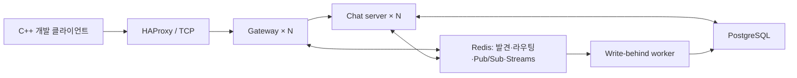

# 기초 코어와 MSA 채팅

Dynaxis는 C++20 서버 코어와 그 위에 조립한 MSA 채팅 스택이다.

| 계층 | 책임 | 소유 경로 |
|---|---|---|
| 필수 코어 | TCP, framing, 연결/버퍼 수명, 작업 큐, scheduler, 종료, 관측 | core |
| 서비스 기반 | gateway 인증/발견/라우팅, 저장소 adapter, 비동기 적재 | gateway, infra, tools/wb_* |
| 채팅 | 로그인, 룸, 메시지, 귓속말, history, presence, 재접속, 권한/제재 | server |

의존 방향은 앱 → 기반/코어다. core는 server/gateway 구현을 참조하지 않는다. bootstrap은 서비스 인스턴스를 명시적으로 주입한다. 기본 생성자의 일부 Registry 호환 경로는 남아 있으므로 새 조립 코드는 명시적 의존성을 사용한다.

기본 구성은 HAProxy → gateway → server와 Redis/Postgres/worker를 실행한다. 최소 `BUILD_CORE_EXTENSIONS=OFF` 구성은 TCP runtime만 빌드·설치하며 Boost 외의 앱 의존성을 요구하지 않는다. `BUILD_CORE_EXTENSIONS`는 MSA 프로토콜·저장소 통합을 포함할지 결정한다.

채팅 서버는 사용자/룸/history/재접속 lease를 Postgres에 직접 조회·저장한다. session 이벤트는 별도의 Redis Streams → worker → Postgres 경로로 적재한다. Redis Pub/Sub으로 노드 간 전달하고, TTL 상태로 발견·presence·라우팅·마지막 방을 관리한다. Pub/Sub은 장애 중 메시지 보존을 보장하지 않는다.

기초 범위에 없는 기능은 활성 소스와 빌드에서 제거했다. 변경 계약은 [4.0 migration](../core-api/foundation-v4-migration.md)에 있다. 새 기능은 사용 사례, 책임/데이터 계약, 실패 경계, 검증 기준을 먼저 정한 뒤 추가한다.

클라이언트는 C++ 개발 도구다. NetClient의 TCP/프로토콜 구현은 UI 의존성이 없으며 현재 ImGui 화면은 교체할 수 있다. GUI 스택은 ImGui/GLFW/OpenGL로 통일하고 Windows와 Linux에서 같은 소스를 사용한다.

