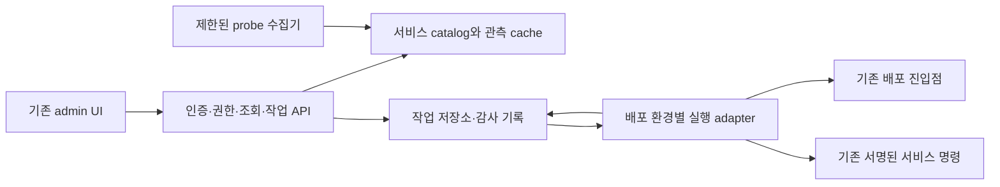

# 전체 마이크로서비스 관리 도구 설계안

## 목표와 현재 상태

관리 도구는 운영자가 **어떤 서비스가 배포되어 있고, 무엇이 응답하지 않으며, 어떤 변경이 실제 적용됐는지** 한곳에서 판단하게 해야 한다. 필수 코어에는 배포·클러스터·채팅 운영 규칙을 넣지 않는다. 기존 `admin_app`을 제어면으로 발전시키고 `gateway_app`, `server_app`, `wb_worker`는 각자의 데이터 처리 책임을 유지한다.

이 문서는 후속 구현을 위한 설계안이다. 아래 제안 API와 화면이 이미 구현되었다는 뜻은 아니다. 현재 제공 API의 기준은 [admin_app README](../../tools/admin_app/README.md)다.

| 영역 | 현재 구현 | 부족한 부분 / 다음 책임 |
|---|---|---|
| 상태 조회 | `/overview`, `/instances`, instance detail, session/user 조회 | instances는 채팅 backend registry다. gateway/worker/admin/HAProxy/Redis/Postgres까지 포함한 서비스 목록이 필요하다. |
| 의존성과 관측 | readiness, worker metrics, Grafana/Prometheus 링크 | registry, 프로세스 존재, 실제 probe, 수집 시각을 구분하는 전체 서비스 상태 모델이 필요하다. |
| 운영 쓰기 | 권한, read-only, 감사 로그, 서명된 disconnect/moderation/settings | publish/접수 성공과 각 target의 적용 완료를 구분하고 작업별 진행 상태를 보여 줘야 한다. |
| 배포/스케일 | 표준 `deploy_docker.ps1`, 생성된 topology overlay, world topology API | 현재 topology 제어는 world/replica 중심이다. 전체 서비스 배포 상태와 live scaling의 실제 실행 증거를 대신하지 않는다. |
| UI | `/admin`의 instance/world/user/worker 화면 | 전체 서비스·의존성·작업 이력을 첫 화면으로 두고, 채팅/world 운영은 별도 기능 영역으로 둔다. |
| 구현 구조 | `tools/admin_app/main.cpp`에 인증·조회·운영·world·확장 배포 집중 | 기능을 더 붙이기 전에 책임별 module로 나눠야 한다. |

이번 기반 정리에서는 HTTP probe를 `http_client.{hpp,cpp}`로 분리했다. 단일 조회 deadline 1.5초, 헤더 16KiB, decoding 후 본문 1MiB 상한을 두고, Content-Length/chunked framing으로 응답 완료를 판단한다. 응답을 닫지 않는 노드 때문에 기존 무제한 read가 계속 대기하는 문제를 줄인다. 전체 poll의 병렬 수/총 시간 예산과 DNS 환경별 취소 지연은 별도 검증 대상이다.

## 서비스 모델

**서비스 정의**, **실행 인스턴스**, **관측 샘플**, **운영 작업**을 별도로 저장한다.

- 서비스 정의: `service_id`, 종류(`application`, `infrastructure`, `job`), 환경, 원하는 replica 수, 의존성, 허용 capability, probe와 dashboard 참조. 토큰/비밀번호/연결 문자열 값은 포함하지 않는다.
- 실행 인스턴스: 배포 adapter가 보고한 `instance_id`, service ID, 배포 revision, image digest, runtime 위치와 실행 상태. registry에 등록되지 않는 gateway/worker/infra도 표현해야 한다.
- 관측 샘플: source, `observed_at`, 마지막 성공 시각, health/readiness/지연/오류 분류. registry heartbeat와 HTTP 결과를 덮어쓰지 않고 각각 보관한다.
- 운영 작업: `operation_id`, actor, capability, 고정한 target 목록/revision, 요청 내용 요약, target별 결과, 시작/종료 시각, timeout과 감사 참조.

초기 목록은 신뢰하는 배포 설정에서 만들고, Docker adapter와 backend registry 관측을 합친다. [로컬 topology JSON](../../docker/stack/topologies/default.json)은 server 노드 목록만 가진다. 이것 하나를 전체 서비스 catalog라고 취급하지 않는다. 선택적인 observability profile과 완료 후 종료되는 migrator도 정의에 포함한다. 의도한 replica 0개와 예상하지 않은 인스턴스 소실은 다른 상태다.

HTTP probe 주소는 관리자가 배포한 catalog에서만 정한다. 브라우저가 전달한 임의 URL로 관리 서비스가 요청을 보내는 API는 만들지 않는다. Redis/Postgres 비밀번호나 컨테이너 전체 env를 브라우저에 반환하지 않고 adapter에서 요약한 결과만 사용한다.

## 상태 판정과 장애 격리

프로세스가 존재하거나 `/healthz`가 200이라는 사실만으로 트래픽을 받을 준비가 됐다고 표시하지 않는다.

| 표시 상태 | 판정 원칙 |
|---|---|
| `unknown` | 아직 관측하지 않았거나 수집 결과가 만료됨. 이전 ready 값을 현재 ready로 표시하지 않는다. |
| `ready` | 최신 관측에서 기대한 인스턴스와 readiness 조건을 충족함. |
| `degraded` | 일부 replica, 의존성, 전달 지연/오류가 기준을 벗어남. 원인을 함께 보여 준다. |
| `unavailable` | 기대한 인스턴스가 없거나 최신 probe에서 사용 불가가 확인됨. |
| `maintenance` | 명시적으로 drain/정지 작업 중임. 관리자의 의도와 실제 readiness를 함께 보존한다. |
| `completed` | migrator 같은 일회성 job이 성공 종료함. 지속 서비스의 준비 상태로 변환하지 않는다. |

개별 target 실패는 다른 target 수집을 막지 않아야 한다. probe에는 개별 deadline/본문 상한뿐 아니라 제한된 동시 실행 수와 poll 전체 시간 예산을 적용한다. 하나의 느린 backend가 UI 요청 스레드나 전체 snapshot을 붙잡지 않게 하고, UI 요청은 완료된 캐시만 읽는다. 관측이 오래되면 시각과 stale 사유를 표시한다.

관리 서비스가 준비됐다는 사실은 모든 데이터 서비스가 정상이라는 의미가 아니다. 제어면 자체의 health/readiness와 관리 대상의 상태를 구분해야 장애 중에도 운영자가 상황을 볼 수 있다.

## 화면과 API 제안

화면은 기존 `/admin`에 다음 순서로 도입한다.

1. **전체 서비스**: 환경별 서비스/replica 목록, 상태, 배포 revision, 마지막 관측 시각, 미충족 의존성.
2. **서비스 상세**: instance 목록, health/readiness 근거, 지연/queue/오류 지표와 로그·대시보드 링크. 로그 저장과 검색은 기존 관측 도구를 사용한다.
3. **운영 작업**: target, 요청자, 진행 상태, 실패 사유, 감사 기록. 버튼을 누른 결과가 접수인지 적용 완료인지 명확히 표시한다.
4. **채팅 운영**: 기존 사용자·룸·공지·제재·설정. world/확장 배포는 사용 중인 서비스에만 별도 capability로 노출한다.

제안 API는 기존 응답 envelope/역할 정책을 재사용한다. 현재 `/instances`의 의미를 갑자기 전체 서비스로 바꾸지 않는다.

| 제안 API | 책임 |
|---|---|
| `GET /api/v1/services` | 전체 서비스 요약과 snapshot freshness |
| `GET /api/v1/services/{service_id}` | 원하는 상태, 실제 instance, 의존성, 관측 근거 |
| `GET /api/v1/operations` 및 `/{operation_id}` | 작업과 target별 진행 상태 |
| `POST /api/v1/operations` | 사전 검증 후 허용한 작업을 접수. 접수 시 202와 operation ID 반환 |

조회는 viewer, 제한된 운영은 operator, 배포/권한 변경은 admin capability로 나눈다. 권한이 없는 작업은 서버에서 거절한다. UI에서 버튼만 숨기는 것으로 권한을 구현하지 않는다. 기존 read-only 모드도 모든 새 쓰기 API에 적용한다.

초기 도입은 조회 전용이다. 쓰기는 기존에 검증된 작업부터 연동하고 restart/scale/deploy는 실행 adapter와 복구 검증 후 추가한다. 현재 admin 기본 인증은 `off`다. gateway/server는 signed 인증을 제공하고 로컬 compose만 development를 명시한다. 관리 인증과 클라이언트 인증은 각자의 경계에서 구성해야 하며, 클라이언트 로그인 권한을 관리 권한으로 재사용하지 않는다.

## 작업 실행과 배포 도구의 경계

제어면은 실행할 작업의 의도/target/revision을 기록하고 adapter는 실행 및 결과를 보고한다. compose 명령을 HTTP handler에서 동기 실행하거나 web 프로세스에 Docker socket을 직접 노출하는 형태를 기본으로 삼지 않는다. adapter가 수락했다는 상태도 새 revision이 실제 ready라는 뜻은 아니다.

작업 상태는 `queued -> running -> succeeded|failed|timed_out`으로 두고 target별 결과를 남긴다. 같은 `idempotency_key`로 같은 요청을 재전송하면 같은 작업을 반환하고, 내용이 다르면 충돌로 거절한다. 명령 접수 후 target이 사라졌거나 revision이 달라졌으면 실패/재검토 상태로 남기며 다른 target에 자동 대입하지 않는다. 성공은 adapter 응답만이 아니라 작업별 후조건으로 판정한다.

Docker runtime 실행은 [기존 배포 스크립트](../../scripts/deploy_docker.ps1)를 유지한다. 이 스크립트는 현재 stack 단위이며 target별 restart/배포 계약은 없다. per-service 기능을 구현할 때는 이 진입점에 명시적 인수를 추가하고 검증한다. 별도 wrapper나 명령 문자열 실행 통로를 만들지 않는다. Kubernetes의 world adapter 계약은 전체 서비스의 Kubernetes 배포 실행기로 간주하지 않는다.

설정은 서비스별 타입·허용 범위·적용 방식(runtime/restart 필요)을 가진 schema로 관리한다. 환경 변수 전체 편집기를 제공하지 않는다. 변경 전 값/revision, target, 적용 결과를 기록하고 rollback 가능 범위도 schema에 둔다. 비밀 값은 secret 참조만 다룬다.

## 구현 순서와 완료 기준

| 단계 | 산출물 | 완료 기준 |
|---|---|---|
| 0. 제어면 정리 | probe 분리/상한, auth/권한·snapshot·chat/world/extension route의 module 분리 | 기존 admin API·read-only·감사 계약 유지. 느린 node가 조회와 종료를 무기한 막지 않음. 이번에는 probe 분리/상한부터 구현. |
| 1. 전체 서비스 조회 | 서비스 catalog, 배포 관측 adapter, `/services`, 전체 서비스 화면 | gateway/server/worker/admin/HAProxy/Redis/Postgres/migrator와 optional observability를 구분. 장애·stale·scale 0·job 완료를 재현. |
| 2. 기존 운영 작업 통합 | operation store, idempotency, target 결과 | 접수/적용/실패/timeout 구분, 재시도 중복 방지, viewer/read-only 거절, 감사 기록 검증. |
| 3. 배포/복구 | canonical script 확장, 실행 adapter, drain/restart/rollback | 일부 target 실패와 adapter 재시작 후에도 결과를 복구. 새 revision의 readiness 확인 후 완료. |

관리 도구는 서버 플랫폼을 쓰고 운영하는 수단이다. 이 설계를 이유로 새 service mesh, 별도 프런트엔드 framework, 범용 workflow 엔진을 먼저 도입하지 않는다. 우선 기존 MSA 채팅을 운영하면서 필요한 경계와 실패 동작을 확인한다.
