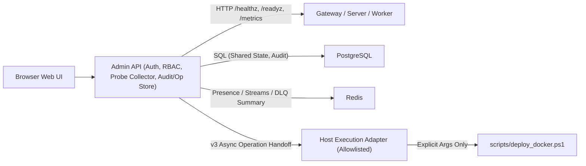
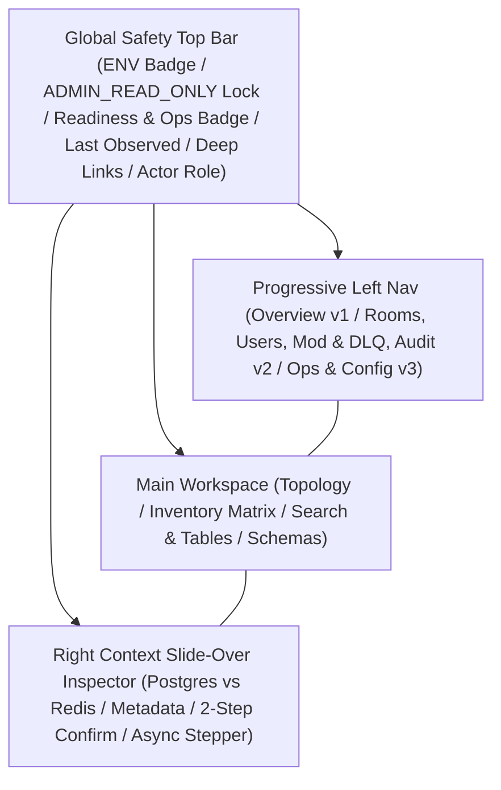

# 웹 관리 콘솔 및 운영 제어면 설계

> **문서 상태 구분**
> - **현재 구현 상태(Baseline 4.0.0 + Step 2 `v1` + Step 3 `v2` + Step 4 `v3`)**: `admin_console/`(`admin_console_core`, `admin_app`), 무빌드 정적 웹 UI(`admin_console/web/`), 호스트 실행 어댑터(`tools/admin_host_adapter.py`), 마이그레이션(`0003_admin_control_plane_v2.sql`, `0004_admin_control_plane_v3.sql`)으로 **v1(조회 전용 인벤토리·bounded probe)**, **v2(채팅방/세션 진실 소스 대조, `mute`/`ban`/`kick`/방 종료, Write-Behind DLQ 재처리, 감사·멱등 원장)**, **v3(허용 서비스 비동기 재시작 4단계 검증 스테퍼 및 스키마 기반 설정/롤백)**가 모두 구현되어 Docker Compose (`admin`, 기본 호스트 포트 `39200:9200`)에 통합되었다([관측](../ops/observability.md), [운영 확인](../ops/runbook.md)).

## 목적과 아키텍처 경계

웹 관리 콘솔의 목적은 운영자와 개발자가 **브라우저 한 곳에서 전체 MSA 채팅 스택의 준비 상태를 판단하고, 채팅 도메인 운영과 복구 작업을 안전하게 감사·실행**할 수 있게 하는 것이다. 이를 위해 다음 세 가지 아키텍처 경계를 먼저 고정한다.

1. **`server_core` 비오염 ([코어와 MSA](core-and-msa.md))**
   - **경계**: `core`에는 웹 서버, 관리 HTTP 라우트, 컨테이너 제어, 채팅 제재 규칙을 넣지 않는다. 관리 API는 별도의 얇은 제어면 어댑터로 분리한다.
   - **이유와 위반 시 문제**: 재사용 가능한 TCP 런타임 코어에 배포·관리 개념이 역류하면 최소 `BUILD_CORE_EXTENSIONS=OFF` 구성이 깨지고, 채팅 외 다른 앱에서 코어를 재사용할 수 없게 된다.
2. **기존 관측 스택(Prometheus/Grafana/HAProxy)과 역할 분리**
   - **경계**: 시계열 메트릭 차트와 알림 규칙 평가는 Prometheus/Grafana에 위임하고 콘솔 안에 그래프 엔진을 재구현하지 않는다. 콘솔에는 대시보드 딥링크를 제공하고, 콘솔 자체는 **현재 상태 판정(인벤토리·readiness), 채팅 도메인 운영, 복구/감사 작업**에 집중한다.
   - **이유와 위반 시 문제**: Grafana가 이미 제공하는 시계열 차트를 복제하면 유지보수 대상만 두 배로 늘어나고 지표 정의가 서로 어긋난다.
3. **범용 컨테이너 오케스트레이터(Portainer류) 지양**
   - **경계**: 임의의 컨테이너 생성·삭제, 웹 셸 실행, 전체 `.env` 자유 편집기를 제공하지 않는다. 콘솔은 **사전 등록된 Dynaxis 서비스 카탈로그**와 **타입·범위가 검증된 운영 스키마** 안에서만 동작한다.
   - **이유와 위반 시 문제**: 범용 Docker 관리 툴을 직접 내장하면 웹 취약점이 곧바로 호스트 권한 탈취로 이어지고, `CHAT_AUTH_SIGNING_SECRET`·DB 자격·포트 불변식이 쉽게 파손된다.

---

## 단계별 사용 사례 (v1 → v2 → v3)

기능을 한 번에 도입하지 않고 위험도와 의존성이 낮은 순서대로 세 단계로 나눈다.

### v1. 조회 전용 서비스 인벤토리·진단 (Read-Only)

- **전체 서비스 상태 매트릭스**: `haproxy`, `gateway-1..N`, `server-1..N`, `wb_worker`, `redis`, `postgres`, 일회성 작업(`migrator`), 선택 `observability` 서비스(`prometheus`, `grafana`, `redis_exporter`, `postgres_exporter`)의 기대 상태 대비 실제 상태를 한 화면에서 확인한다.
- **상태 판정 구분**: 단순 프로세스 생존(`/healthz`)과 트래픽 수신 가능 상태(`/readyz`), 일회성 초기화 완료(`completed`), 관측 만료(`unknown`), 일부 장애(`degraded`/`not_ready`)를 구분한다.
- **도메인·큐 요약 및 딥링크**: 활성 세션 수, 활성 방 수, Write-Behind pending 및 DLQ 적체 건수를 요약 표시하고, 상세 추이는 Grafana(`33000`) 및 HAProxy Stats(`8404`) 링크로 연결한다.

### v2. 채팅 도메인 운영·복구 보조 (Chat Operations & Audit)

- **클라이언트 접속 없는 방 관리**: 현재 활성 방 목록·인원·세대 ID(`room_id`)를 조회하고, 비정상 방이나 잔여 방을 강제 해산(`/room remove` 상당)한다.
- **사용자(`subject`)·세션 조회**: 표시 이름(`display_name`)이 아닌 검증된 `subject`(`principal_id`) 기준으로 현재 로그인 lease, 마지막 방, 최근 연결/제재 상태를 조회한다.
- **전역 제재 및 연결 종료 UI화**: 현재 활성 중인 `mute`/`ban` 목록과 만료 시각을 조회하고, 신규 제재 부여·조기 해제(`unmute`, `unban`)·강제 연결 종료(`gkick`)를 사유와 함께 실행한다.
- **Write-Behind DLQ 조회 및 재처리 트리거**: DLQ 적체 요약과 실패 원인을 확인하고, [wb_dlq_replayer](../../tools/wb_dlq_replayer/README.md) 계약에 맞춘 재처리를 안전하게 요청한다.
- **운영 감사 로그(Audit Log)**: 누가 언제 어떤 대상에 어떤 운영 작업을 요청해 성공/실패했는지 감사 이력을 기록하고 조회한다.

### v3. 제한된 라이프사이클·스키마 설정 제어 (최종 선택 단계)

- **허용 서비스의 안전한 재시작**: 사전 카탈로그에 등록된 서비스(`gateway-*`, `server-*`, `wb_worker`)에 한해 선택적 Drain → 재시작 → `/readyz` 복구 검증을 비동기 작업으로 수행한다.
- **스키마 기반 운영 설정 변경**: 허용된 범위가 정의된 운영 설정(예: 채팅 제한 정책, 검증된 [스택 토폴로지](../../docker/stack/README.md) 프리셋 선택)을 변경한다. 각 항목은 **즉시 반영(`runtime`)** 인지 **재시작 필요(`restart_required`)** 인지 명시한다.

---

## 시스템 구성, 보안 및 API 데이터 계약

### 보안·권한 경계

이 경계들은 UI에서 버튼을 숨기는 것으로 대신하지 않으며 **서버 측 인가 계층**에서 강제한다.

- **관리 인증과 채팅 인증 분리**: 일반 클라이언트 채팅 로그인(`access_token` / `is_admin`)을 웹 관리 콘솔 인증 토큰으로 재사용하지 않는다. 관리 콘솔은 별도의 관리 인증 경계를 사용한다.
- **최소 권한 RBAC 및 안전 스위치**:
  - `viewer`: v1 서비스·도메인·감사 로그 조회만 허용한다.
  - `operator`: 조회 + v2 채팅 방 해산, 제재 부여/해제, 강제 연결 종료, DLQ 재처리 요청을 허용한다.
  - `admin`: 조회·채팅 운영 + v3 허용 서비스 재시작 및 스키마 설정 변경을 허용한다.
  - `ADMIN_READ_ONLY=1`: 설정된 경우 역할과 무관하게 모든 쓰기·작업(`POST`/`DELETE` 등)을 서버에서 거절한다.
- **비밀값 비노출**: `CHAT_AUTH_SIGNING_SECRET`, DB/Redis 비밀번호, 사용자 `access`/`resume` 토큰 원문, 컨테이너 전체 환경변수(`.env` 원문)는 API 응답·진단 화면·감사 상세·에러 로그에 **절대 포함하지 않는다**.
- **SSRF 차단**: HTTP probe 대상 URL은 서버가 기동 시 읽은 신뢰 가능한 배포 카탈로그에서만 결정한다. 브라우저 입력 URL이나 쿼리 파라미터로 내부 네트워크에 probe 요청을 보내는 API는 허용하지 않는다.
- **호스트 Docker 소켓 격리**: 웹 백엔드 컨테이너에 `/var/run/docker.sock`을 직접 마운트하거나 HTTP 핸들러에서 동기 셸 명령 문자열을 조합·실행하지 않는다. v3 라이프사이클 작업은 제어면이 작업 의도를 큐에 기록하면 호스트 측 제한 어댑터가 [배포 스크립트](../../scripts/deploy_docker.ps1)의 명시적 허용 인수만 호출해 수행한다.

### 상태 판정 모델 및 제안 API 계약

#### 1. 서비스 인벤토리 상태 판정 (`GET /api/v1/services`, `GET /api/v1/services/{service_id}`)

서비스 정의는 `kind`(`application`, `infrastructure`, `job`), 기대 인스턴스 수(`desired_count`), 허용 capability, 대시보드 참조를 가지며, 실제 관측(`observed_at`)과 분리해 보관한다.

| 표시 상태 | 적용 대상 | 판정 기준 |
|---|---|---|
| `ready` | 상주 서비스 | 최신 유효 관측에서 기대 인스턴스가 모두 `/healthz` 및 `/readyz` 조건을 충족함 |
| `degraded` | 상주 서비스 | 일부 인스턴스만 정상이거나 의존성 지연/큐 적체/DLQ 경고가 임계치를 넘음 |
| `not_ready` | 상주 서비스 | 기대 인스턴스가 없거나(`/readyz` 실패 포함) 트래픽 처리가 불가능함 |
| `completed` | 일회성 job (`migrator`) | 정상 종료 코드로 초기화·마이그레이션을 완료함 |
| `unknown` | 전체 | 아직 관측되지 않았거나 `observed_at` TTL이 만료(stale)됨 |

#### 2. 채팅 도메인 운영 API (v2)

| 엔드포인트 | 역할 | 데이터 기준 및 주의점 |
|---|---|---|
| `GET /api/v1/chat/rooms` | 활성 방 목록·인원·세대 조회 | 권한·소유자·초대 목록의 진실 원천은 [기초 계약](foundation-contracts.md)에 따라 Postgres `chat_shared_state` |
| `GET /api/v1/chat/users/{subject}` | 신원·세션·제재 상태 조회 | `display_name`이 아닌 소문자 ASCII `subject` 기준 조회; Redis TTL presence와 DB lease 구분 표시 |
| `GET /api/v1/chat/sanctions` | 활성 mute/ban 목록 조회 | 만료 시각·사유·부여 주체 표시 |
| `POST /api/v1/chat/sanctions`, `DELETE /api/v1/chat/sanctions/{id}` | 제재 부여/조기 해제 (`operator`+) | 실행 전 감사 로그 선기록·후결과 갱신; `access`/`resume` 토큰 미노출 |
| `POST /api/v1/chat/rooms/{room}/close` | 방 강제 해산 (`operator`+) | 방 세대 종료 후 참여자 로비 복귀 유도 |
| `POST /api/v1/chat/users/{subject}/kick` | 전역 강제 연결 종료 (`operator`+) | 대상 세션 종료 및 lease 정리 경계 준수 |
| `POST /api/v1/wb/dlq/replay` | DLQ 재처리 작업 요청 (`operator`+) | 재시도 예산 초과 항목의 DEAD 스트림 분리 계약 유지 |
| `GET /api/v1/audit-logs` | 운영 감사 이력 조회 (`viewer`+) | actor, capability, target, idempotency_key, 전후 요약, 결과 기록 |

#### 3. 비동기 운영 작업 API (v3: `POST /api/v1/operations`, `GET /api/v1/operations/{operation_id}`)

- **접수와 완료 분리**: 변경·재시작 요청은 즉시 완료로 응답하지 않고 검증 후 `202 Accepted`와 `operation_id`를 반환한다.
- **상태 전이**: `queued -> running -> verifying -> succeeded | failed | timed_out`.
- **멱등성 보장**: 모든 쓰기 작업은 클라이언트가 생성한 `idempotency_key`를 요구한다. 동일 키·동일 요청 재전송 시 기존 작업을 반환하고, 동일 키·다른 내용이면 충돌(`409`)로 거절한다.
- **설정 스키마 메타데이터**: 각 설정 항목은 `type`, `min`/`max` 또는 `allowed_values`, `apply_mode`(`runtime` 즉시 반영 vs `restart_required`), `secret_ref`(값 비노출 참조 여부)를 정의한다.

---

## 화면 구조 및 UI/UX 디자인 명세 (UI/UX Specification)

> 본 절은 **웹 관리 콘솔 v1~v3(`admin_console/web`)의 레이아웃·상태 표현·안전 가드 기준 사양**이며 `Step 2~4` 구현에 모두 반영되어 있다.

### 1. 시각 언어 및 상태 표현 규칙

- **Slate Dark 팔레트 통일**: `client_gui`와 동일한 계통의 다크 서피스(`#16181D` 배경, `#1E2028` 패널/사이드바, `#2A2E39` 카드·입력 필드)와 단일 블루 액센트(`#3B82F6` 계열)를 채택한다. 클라이언트 워크벤치와 콘솔을 나란히 띄워도 시각적 이질감과 눈의 피로가 적고, 장애 상태 배지가 배경에 묻히지 않는다.
- **고정폭 식별자 및 숫자 정렬 (`tabular-nums`)**: `room_id`, `principal_id`(`subject`), `logical_session_id`, `operation_id`, `idempotency_key`, 지연(ms), `watermark`, 타임스탬프는 반드시 `monospace` + `tabular-nums`를 사용한다. 수 초 간격의 상태 폴링이 일어나더라도 표의 열 너비가 좌우로 흔들리지 않아 운영자가 수치를 안정적으로 판독할 수 있다.
- **색상 + 아이콘 + 라벨 동시 표기 (5종 상태 시맨틱)**: 색상만으로 상태를 구분하면 색각 이상이나 순간 판독 시 정상 종료(`migrator`)와 장애를 혼동한다. 모든 배지와 인벤토리 셀은 아래 3요소 조합을 강제한다.

| 상태 코드 | 표시 배지 | 대상 및 판정 의미 | 미구분 시 발생하는 운영 오판 |
| :--- | :--- | :--- | :--- |
| `ready` | 초록 `● Ready` | 상시 가동 인스턴스가 `/healthz` 및 필수 `/readyz`를 통과함 | - |
| `degraded` | 주황 `▲ Degraded` | 응답은 가능하나 복제본 일부 비준비, WB 적체·DLQ 발생 등 부분 저하 | - |
| `not_ready` | 빨강 `✕ Not Ready` | `/healthz` 실패 또는 상시 가동 인스턴스가 트래픽/처리 준비 미달 | - |
| `completed` | 청회 `✓ Completed` | `migrator` 등 `one-shot` 작업이 `exit 0`으로 정상 종료됨 | 정상 종료된 `migrator`를 장애(`Down`)로 착각해 불필요한 재기동을 시도함 |
| `unknown` | 회색 `? Unknown / Stale` | HTTP probe 타임아웃·연결 실패 또는 갱신 SLA 초과(`observed_at` 동반 표기) | 통신 두절 상태의 오래된 캐시 값을 현재 `ready`로 오판함 |

### 2. 전역 애플리케이션 셸 (Global App Shell)

- **Global Safety Top Bar (상단 안전 막대)**:
  - **환경 배지 (`LOCAL` / `DEV` / `PROD`)**: 현재 제어 중인 스택 환경을 항상 왼쪽 상단에 고정 표시해 개발 환경과 실서비스 혼동을 원천 차단한다.
  - **`ADMIN_READ_ONLY=1` 고정 잠금 배너**: 읽기 전용 모드가 켜져 있으면 주황/중립 잠금 배너(`Read-Only Mode — Mutating Actions Disabled`)를 상단에 상시 노출한다. 운영자가 쓰기 버튼을 누르기 전에 현재 세션의 변경 가능 여부를 즉시 인지할 수 있다.
  - **스택/작업 요약 및 데이터 신선도**: `Ready N/M` 요약 배지, 진행 중 비동기 작업 수(`Running Ops`), 마지막 전체 관측 경과 시간(`Last observed Ns ago`)과 수동 새로고침 버튼을 둔다. 개별 probe 지연이 있어도 `observed_at` 기준 age를 보여 주어 거짓 실시간성을 피한다.
  - **외부 관제 딥링크**: Grafana(`:33000`), Prometheus(`:39090`), HAProxy Stats(`:8404`) 바로가기 버튼을 상단에 배치해 시계열 메트릭·로그 탐색을 위임한다.
  - **행위자 역할 배지**: 로그인한 계정의 현재 권한(`viewer` / `operator` / `admin`)을 명시한다.
- **Progressive Left Navigation (단계적 좌측 내비게이션)**:
  - `v1`: `Overview`
  - `v2`: `Chat Rooms`, `Users & Sessions`, `Moderation & DLQ`, `Audit Log`
  - `v3`: `Operations & Config`
  - 미도입 단계 또는 권한 밖 메뉴는 숨기거나 잠금 사유를 표시해 초기 화면 복잡도를 낮춘다.
- **Right Context Slide-Over Inspector Drawer (우측 컨텍스트 인스펙터)**:
  - 테이블에서 방·사용자·인스턴스·작업을 클릭해도 전체 화면을 전환하지 않고 우측 슬라이드오버 드로어로 연다. 전체 인벤토리·토폴로지 맥락을 유지한 채 특정 대상의 세부 진실 소스를 대조할 수 있다.

### 3. 단계별 핵심 화면 디자인 (v1 ~ v3)

#### v1: `Overview` (조회 전용 인벤토리 및 상태판)

1. **4종 요약 KPI 카드**: `Stack Readiness`(상시 서비스 ready 비율), `Active Sessions`(Gateway/Server 기준 활성 연결), `Active Rooms`(활성 채팅방 수), `WB Pending / DLQ`(Write-Behind 일반 대기 vs 데드레터 건수). 각 카드 하단에 데이터 출처와 `Observed Age`를 작게 병기한다.
2. **계층형 토폴로지 스트립 (Layered Topology Strip)**:
   - `HAProxy (:6000 / :8404)` -> `gateway-1..N` -> `server-1..N` -> `Redis / PostgreSQL / wb_worker / migrator` 흐름으로 배치한다.
   - 왜 이 배치를 택하는가: 클라이언트 접속 장애가 발생했을 때 프록시 -> 게이트웨이 -> 채팅 서버 -> 저장소/워커 중 어느 경계에서 끊겼는지 5초 내에 좁힐 수 있고, `migrator`를 상시 서버와 다른 `one-shot` 카드로 분리해 오탐을 막는다.
3. **서비스 인벤토리 매트릭스**:
   - 컬럼: `Service`, `Kind`(`long-running` / `one-shot`), `Desired/Ready`, `/healthz`, `/readyz`, `Probe Latency`, `Observed Age`, `Deep Links`(Grafana/HAProxy 해당 패널).
   - 특정 노드가 응답하지 않아도 bounded probe deadline(예: 1.5s)이 지나면 해당 행만 `? Unknown / Stale`로 표시되고 나머지 행은 정상 갱신된다.

#### v2: `Users & Sessions` 및 `Chat Rooms` (진실 소스 대조 및 프라이버시 경계)

1. **`Users & Sessions`**:
   - **정확한 키 기반 검색**: 표시명(닉네임)은 중복·변동 가능성이 있으므로 검증된 소문자 ASCII `subject`(`principal_id`) 기반 검색임을 검색창 플레이스홀더와 헬프 텍스트로 명시한다.
   - **User Inspector — 진실 소스 나란히 대조**: 우측 드로어 안에 **Postgres Login Lease** 패널과 **Redis Room Presence TTL** 패널을 나란히 배치한다. 두 저장소의 상태가 어긋날 때(예: Postgres Lease는 만료됐는데 Redis 방 참여 키가 남은 경우) 정상 복구 가능 여부를 운영자가 한눈에 진단할 수 있다.
   - **비밀 비노출 불변식**: `access_token`, `resume_token` 원문 또는 복원 가능한 서명 문자열은 API 응답과 UI 어느 곳에도 노출하지 않는다. 오직 토큰 존재 여부, 발급·만료 시각(`expires_at`), 남은 TTL만 표시한다.
2. **`Chat Rooms`**:
   - 방 목록은 `room_id`, 방 이름, 잠금 여부(`is_locked`), 현재 인원수, `watermark`, 최근 활동 상태를 보여 준다.
   - **Room Inspector — 프라이버시 경계**: 참여 멤버와 각 멤버가 연결된 `server` 인스턴스, `watermark` 메타데이터까지만 노출하며 **일반 채팅 메시지 본문 평문 뷰어는 UI에 제공하지 않는다**. 운영 콘솔이 개인 대화 사찰 도구로 변질되지 않게 설계 단계에서 경계를 고정한다.

#### v2: `Moderation & DLQ` 및 `Audit Log` (증적·안전 중심 제어)

1. **Moderation 및 강제 방 정리**:
   - `mute`, `ban`, `gkick` 및 강제 방 닫기/제거 액션 모달은 **감사 사유(`Reason`) 입력을 필수 검증**한다.
   - 지속 시간 선택은 실수로 영구 제재를 걸지 않도록 `5m`, `30m`, `1h`, `24h` 프리셋 버튼을 우선 제공하고 영구 제재는 별도 확인을 거친다.
2. **Write-Behind Pending / DLQ 분리 모니터**:
   - 정상 처리 중인 `WB Pending` 스트림 건수와 실패 격리된 `DEAD / DLQ` 건수를 별도 영역으로 분리 표시해 일시적 트래픽 증가와 영구 저장 실패를 혼동하지 않게 한다.
   - 단건/배치 재처리(`replay`) 실행 시 클라이언트가 생성한 `idempotency_key`를 UI에서 확인·복사할 수 있어 중복 재처리를 방지한다.
3. **`Audit Log`**:
   - `timestamp`, `actor (role)`, `action`, `target`, `reason`, `idempotency_key`, `result`, `operation_id` 컬럼과 기간/행위자/대상 필터를 제공한다.

#### v3: `Operations & Config` (2단계 위험 확인 및 비동기 실행 추적)

1. **2단계 위험 확인 모달 (2-Step Risk Confirmation)**:
   - **1단계 (Blast Radius Preview)**: 대상 인스턴스, 현재 연결된 추정 세션 수, 선행 `/readyz` 확인 조건, 예상 소요/실패 시 동작을 카드로 요약해 영향 범위를 먼저 확인시킨다.
   - **2단계 (명시적 대상 입력 확인)**: `server-2` 같은 정확한 대상 인스턴스 식별자를 직접 타이핑해야 실행 버튼이 활성화된다.
   - **비활성 사유 명시**: `ADMIN_READ_ONLY=1`이거나 권한이 `admin` 미만인 경우 실행 버튼을 단순히 숨기지 않고 비활성(`disabled`) 상태로 둔 채 구체적 사유(`ADMIN_READ_ONLY=1 active` 또는 `Requires admin role`)를 배너·툴팁으로 보여 준다.
2. **4단계 비동기 작업 스테퍼 (4-Stage Async Stepper)**:
   - `Queued` -> `Running (deploy_docker.ps1)` -> `Verifying (/readyz)` -> `Succeeded | Failed | Timed Out` 4단계 진행률과 각 단계 로그 요약을 실시간 추적한다.
   - **왜 필요한가**: 롤링 재시작 중 `server-1`이 아직 `/readyz`를 통과하지 못한 상태에서 운영자가 `server-2`를 연달아 재시작해 채팅방 전체가 동시에 끊기는 연쇄 중단을 막는다. 선행 작업이 `Verifying (/readyz)`를 끝낼 때까지 후속 노드 재시작 잠금 가이드를 UI에 명확히 표시한다.
3. **타입 스키마 기반 설정 폼 (Schema-Driven Config Form)**:
   - `.env` 원문 텍스트 편집기는 제공하지 않는다. 대신 백엔드 스키마(`type`, `min`/`max`, `allowed_values`, `secret_ref`)에 맞춘 숫자·셀렉트·토글 입력만 렌더링하며 비밀 참조(`secret_ref`) 항목은 읽기 전용 마스킹으로 취급한다.
   - 모든 항목에 `[runtime]`(즉시 반영) 또는 `[restart_required]`(설정 저장 후 연동 Operation 필요) 배지를 표시하고, 제출 전 **Before / After Diff 미리보기** 단계를 강제한다.

---

## 실패 처리와 격리

1. **느린 노드로 인한 조회 정지 방지 (Bounded Probe Isolation)**
   - 각 인스턴스의 `/healthz`, `/readyz`, `/metrics` HTTP probe는 개별 짧은 deadline(예: 1.5초), 헤더·본문 크기 상한, 전체 폴링 동시성 제한을 둔다. 응답을 닫지 않거나 멈춘 노드 하나가 다른 서비스 상태 조회나 Admin 서버 종료를 지연시키지 않게 격리한다.
2. **Stale 데이터 오판 방지**
   - 수집기가 멈추거나 일시 네트워크 단절로 최신 샘플이 만료되면 이전 `ready` 값을 그대로 유지하지 않고 `unknown`으로 강등해 운영자가 장애를 정상으로 오인하지 않게 한다.
3. **권한·멱등성 충돌 시 안전 거절**
   - `viewer` 권한이나 `ADMIN_READ_ONLY=1` 환경에서는 모든 변경 요청을 실행 전 단계에서 거절하고 감사 거부 기록을 남긴다.
   - v3 작업 접수 후 실제 실행 시점에 타깃 인스턴스 또는 설정 revision이 달라졌으면 임의로 다른 노드에 적용하지 않고 `failed`로 중단한다.
4. **재시작 후 사후 검증 실패 처리**
   - 호스트 실행 어댑터가 `deploy_docker.ps1` 재시작 명령에서 종료 코드 `0`을 반환하더라도, 대상 노드가 제한 시간 안에 `/readyz`를 회복하지 못하면 작업을 `succeeded`로 마감하지 않고 `timed_out` 또는 `failed`로 기록해 경보를 남긴다.

---

## 도입 순서와 검증 기준

클라이언트 리디자인(`Step 1`)이 끝난 뒤 아래 순서로 구현·검증한다.

| 단계 | 범위 | 완료·검증 기준 |
|---|---|---|
| **v1 (Step 2, 구현 완료)** | 조회 전용 서비스 인벤토리 + bounded probe + Grafana 링크 (`admin_app`) | ① 정상/장애/지연(hung socket)/`migrator` 완료/관측 만료(`unknown`) 시나리오에서 정확한 상태 판정과 응답 상한 확인 (`tests/admin/test_admin_console_v1.cpp`) ② API 응답·로그에 비밀값/원시 env 미포함 검증 |
| **v2 (Step 3, 구현 완료)** | 채팅 운영·제재·DLQ 재처리·감사 로그 (`admin_console`, `0003_admin_control_plane_v2.sql`) | ① 콘솔에서 부여/해제한 mute·ban·방 해산·`gkick`이 실제 클라이언트 세션과 재접속에 즉시 반영되는지 확인 (`tests/admin/test_admin_console_v2.cpp` + 라이브 Docker 검증) ② `viewer` 및 `ADMIN_READ_ONLY=1` 차단, `idempotency_key` 중복/충돌, 감사 로그 기록 확인 |
| **v3 (Step 4, 구현 완료)** | 제한된 인스턴스 재시작 + 스키마 기반 설정 변경 (`ops_config_backend`, `admin_host_adapter.py`, `0004_admin_control_plane_v3.sql`) | ① `deploy_docker.ps1 -Service` 명시 인자를 통해 `server-1` 등 허용 노드 재시작 시 [재접속 계약](../ops/session-continuity-contract.md) 기반 세션 연속성 유지 및 `/readyz` 사후 검증 뒤 `succeeded` 전환 확인 ② 허용 목록 외 타깃·동료 미준비·`operator` 이하 권한·`secret_ref`·범위 초과 설정 거절 확인 (`tests/admin/test_admin_console_v3.cpp`, `tests/python/test_admin_host_adapter.py` + 라이브 E2E) |
